<div align="center">


# Career Wise

**Hiring that explains itself, on both sides of the table.**
Job seekers get a prep pack for every role. Employers get applicants ranked by real skill fit.


[Features](#features) · [Design](#design) · [Screenshots](#screenshots) · [Tech stack](#tech-stack) · [Getting started](#getting-started)

</div>

<picture>
  <source media="(prefers-color-scheme: dark)" srcset="readme/hero-dark.png">
  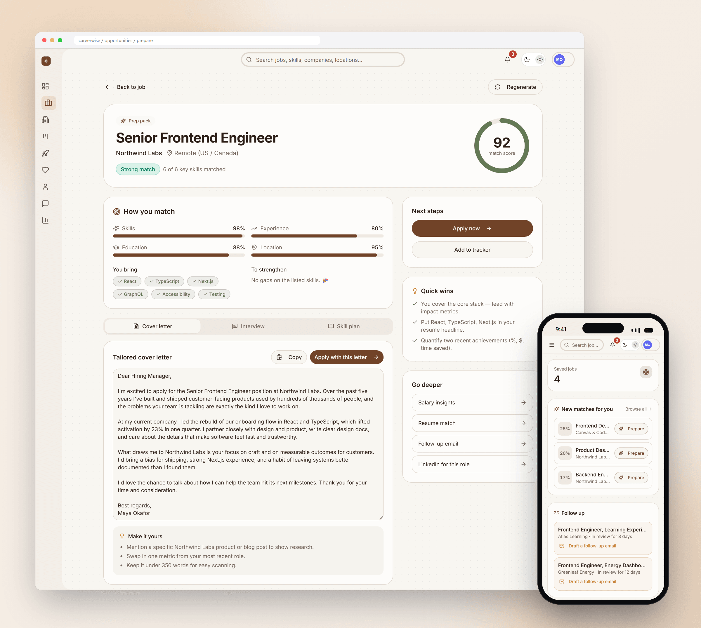
</picture>

## Overview

Career Wise is a two-sided career platform built with Next.js 15, Firebase and Genkit. Job seekers browse roles, see exactly why they match, generate a tailored cover letter, likely interview questions and a skill plan in one click, and track every application on a board that tells them when to follow up. Employers post roles, see candidates ranked by how well their skills cover each posting, and move applicants through a pipeline.

Every AI feature is a Genkit flow running on Gemini 2.5 Flash. Without an API key the app switches to an offline demo model that returns realistic, schema-valid answers, so the whole product runs locally with no paid services.

## Try the demo

Run it locally (see [Getting started](#getting-started)) and click **Try as a job seeker** or **Try as an employer** on the landing page (or **Try demo as …** on `/login`). A guest account is created and seeded on the spot:

- **Job seeker: Maya.** 16 tracked applications (3 interviewing, 3 offers), saved jobs, follow-up reminders and a profile ready for matching.
- **Employer: Northwind Labs.** 4 open roles, ranked candidates, applicants at every stage and company updates.

Demo sign-in turns on automatically with the Firebase emulator, or explicitly with `DEMO_MODE=true`.

## Features

### A prep pack for every job

Open any role and press **Build my prep pack**. You get a match score split into skills, experience, education and location, the skills you bring and the ones to strengthen, a tailored cover letter that pre-fills the application, likely interview questions and a skill plan. Earlier packs are kept, so you can come back before the interview. (Shown in the header image above.)

### Today: what needs you now

The seeker home puts active applications, interviews and offers on top, then new matches with a match percentage, then applications with no reply for seven days or more, each with a one-click follow-up.

<picture>
  <source media="(prefers-color-scheme: dark)" srcset="readme/today-dark.png">
  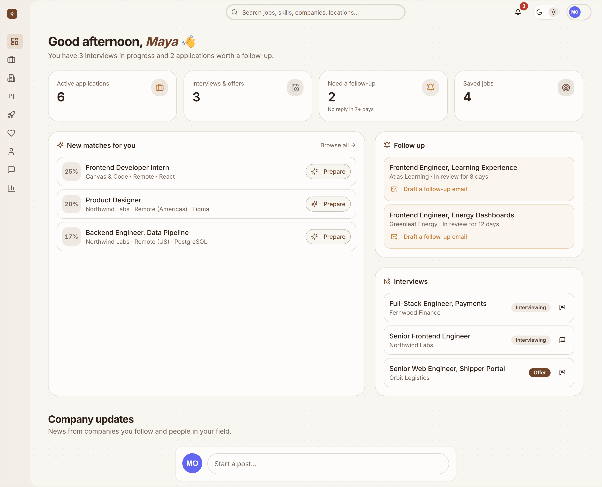
</picture>

### Application tracker

A drag-and-drop board (saved, applied, interview, offer, rejected) built on one shared status model, so the board, the Today page and the employer pipeline always agree on where an application stands.

<picture>
  <source media="(prefers-color-scheme: dark)" srcset="readme/applications-dark.png">
  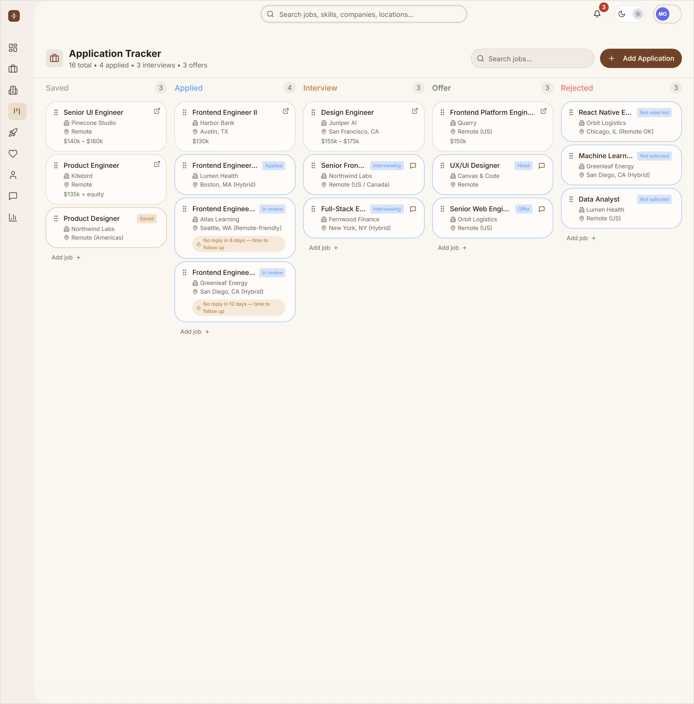
</picture>

### Candidates ranked by skill fit

For each posting, employers see candidates sorted by how much of the required skill list they cover, with matched and missing skills as chips. **Invite** creates an invited application and an in-app notification in one step.

<picture>
  <source media="(prefers-color-scheme: dark)" srcset="readme/emp-applicants-dark.png">
  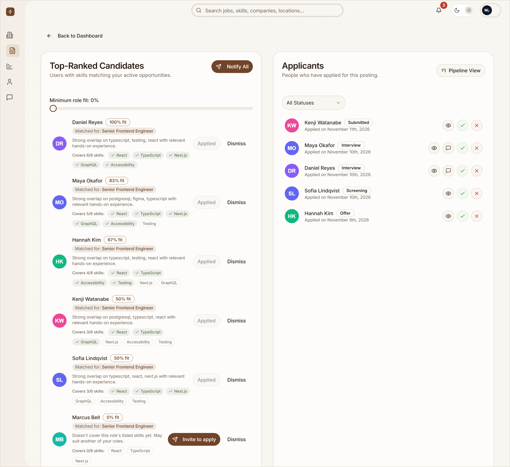
</picture>

### LaunchPad AI tools

Resume match analyzer, resume builder with PDF export, cover letter, interview prep, skill gap, career path, salary negotiation, LinkedIn optimizer and email templates. Tools pre-fill from your profile or a chosen job, and every result is saved to an AI history.

<picture>
  <source media="(prefers-color-scheme: dark)" srcset="readme/ai-tools-dark.png">
  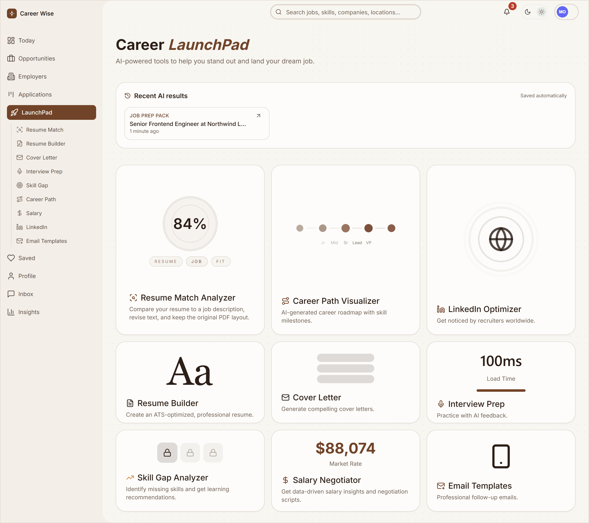
</picture>

### Opportunities with a reason attached

Search by skill, company or location, use the popular-skill and location chips as one-click filters, and see your match percentage next to each role before you open it.

<picture>
  <source media="(prefers-color-scheme: dark)" srcset="readme/opportunities-dark.png">
  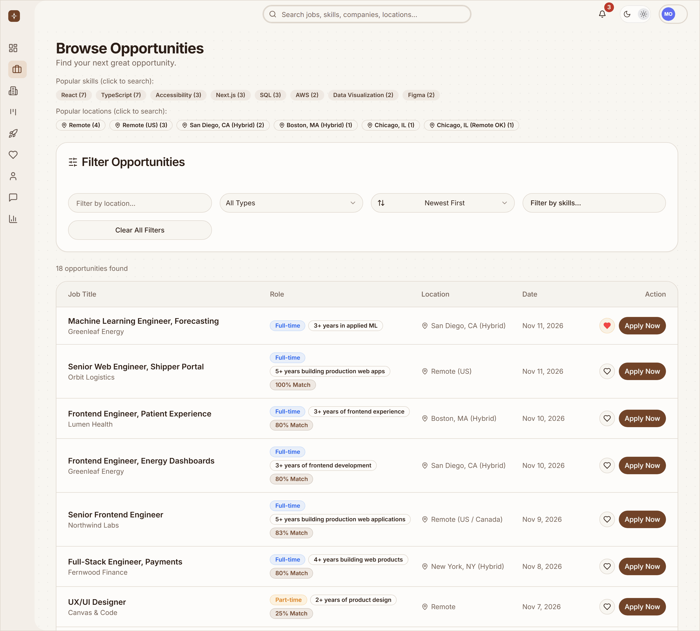
</picture>

### Everything else

| Area | What you get |
|---|---|
| **Profile** | Resume upload with parsing (pdf.js), skills, experience and a public profile |
| **Employer home** | Open roles, applicants this week, decisions waiting and average time to hire |
| **Pipeline** | Stage-by-stage applicant view per posting, with status emails |
| **Analytics** | Employers see applicants per posting and active vs. archived jobs; seekers see their status mix and weekly activity |
| **Inbox and notifications** | In-app messages, invites and status changes |
| **Onboarding** | A 3-step setup for new accounts, picking the seeker or employer role |
| **Billing (optional)** | Plans and checkout through Stripe, with higher AI limits on paid plans |
| **Email (optional)** | Welcome and application-status mail through Resend |
| **Navigation** | Collapsible sidebar, command search, light and dark themes |

## Design

Career Wise uses a warm "espresso" palette instead of the usual SaaS blue: cream surfaces with roast-brown ink in light mode, and roasted-bean near-black with a crema accent in dark mode. Charts draw from a set of latte shades, so a donut or a bar chart sits in the same family as the buttons. Type is Inter throughout, with Source Code Pro for code.

- **Tokens, not hex codes.** Every colour is an HSL variable in `src/app/globals.css` (`--primary`, `--brand-crema`, `--chart-1…5`, sidebar tokens), with a full second set under `.dark`. Components only use the Tailwind names, so the dark theme needed no per-component overrides.
- **One accent per screen.** The brown primary marks the single action that moves you forward: *Build my prep pack*, *Apply with this letter*, *Invite*. Everything else is outlined or ghost.
- **Scores you can read.** A match is never just a number: it comes with four bars (skills, experience, education, location) and the matched and missing skills by name.
- **Responsive by layout, not by hiding.** On a phone the sidebar becomes a drawer, stat tiles go two-up, the prep pack stacks into cards and the tracker scrolls column by column.
- **Calm motion.** Framer Motion handles page entrances and card transitions; nothing moves without a reason.
- **States are designed.** Lists have empty states that point to the next step, and AI results come back in the same layout whether Gemini or the offline demo model produced them.

<p align="center">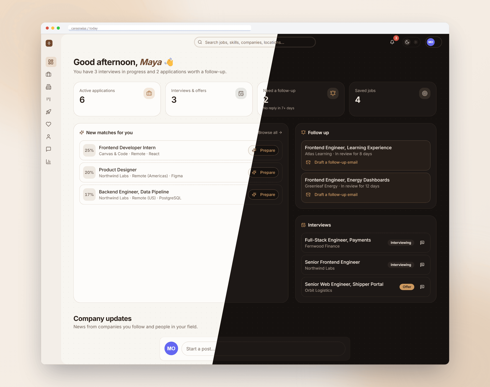</p>

<picture>
  <source media="(prefers-color-scheme: dark)" srcset="readme/mobile-dark.png">
  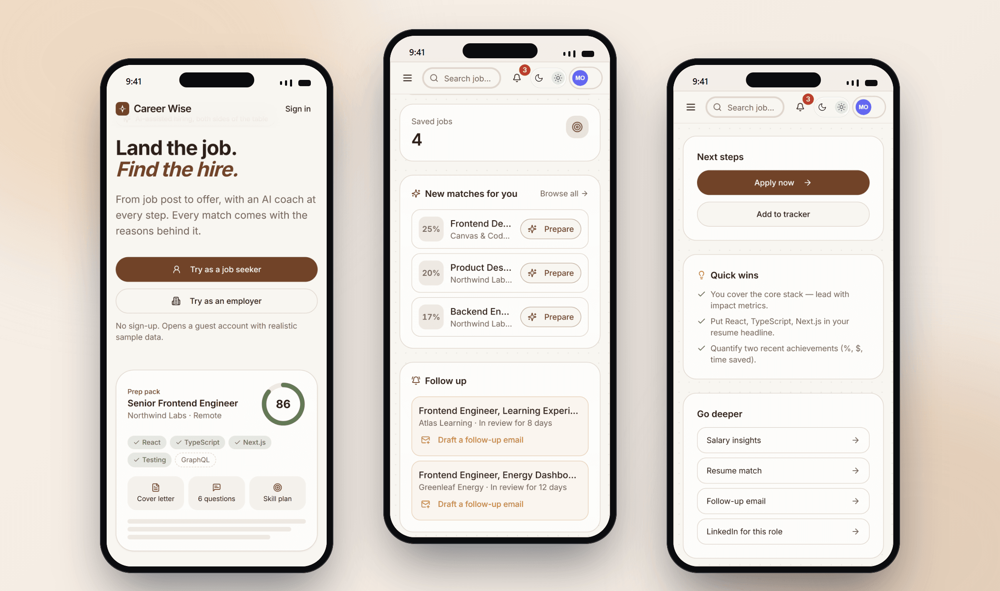
</picture>

## Screenshots

<table>
  <tr>
    <td width="50%">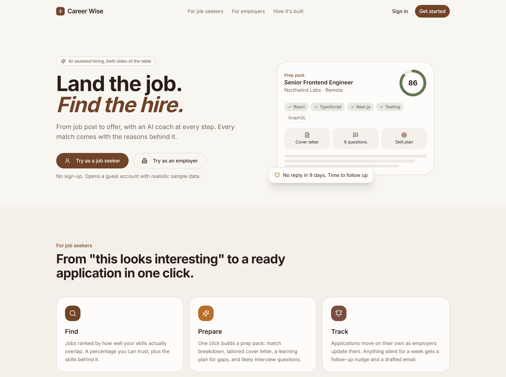<br><sub><b>Landing page</b> with one-click demos for both roles</sub></td>
    <td width="50%">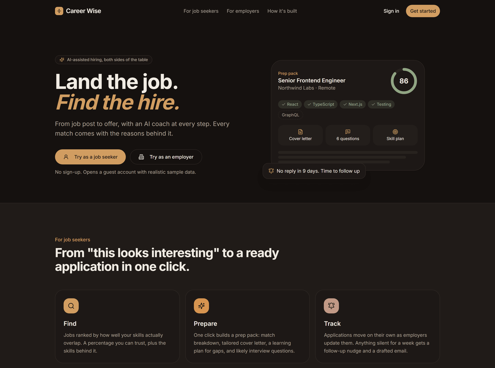<br><sub><b>Landing page</b> (dark)</sub></td>
  </tr>
  <tr>
    <td width="50%">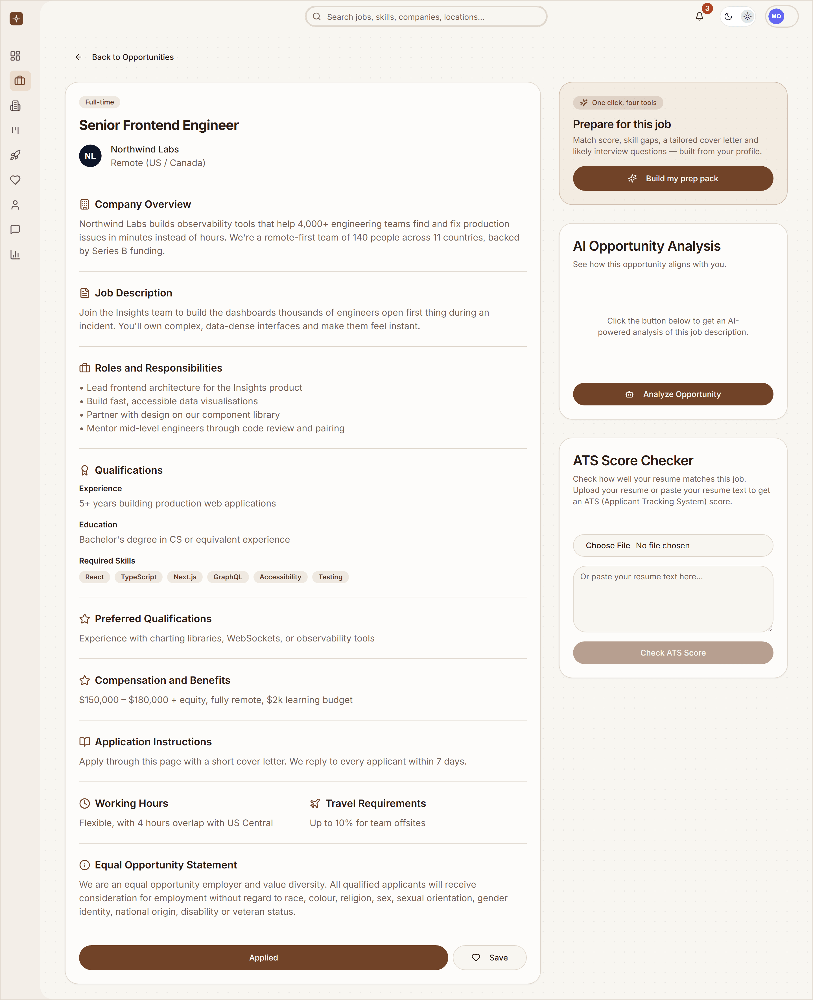<br><sub><b>Job detail</b>: role, requirements and the prep pack entry point</sub></td>
    <td width="50%">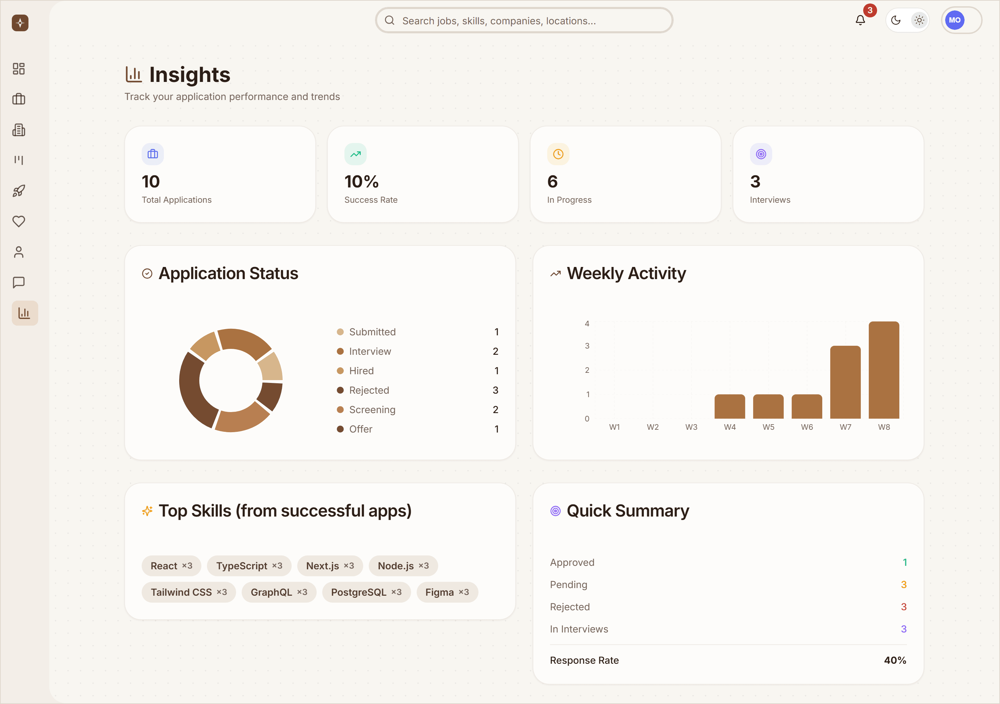<br><sub><b>Insights</b>: application status mix and weekly activity</sub></td>
  </tr>
  <tr>
    <td width="50%">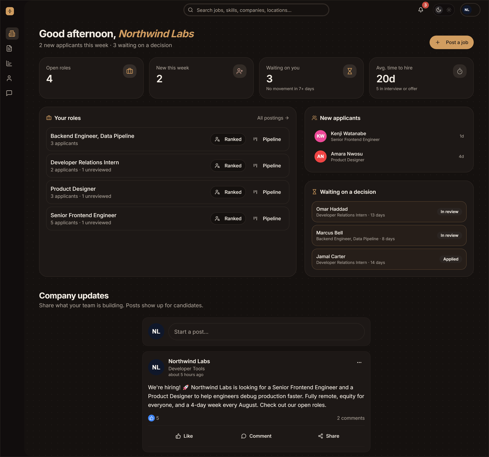<br><sub><b>Employer home</b>: open roles and decisions waiting (dark)</sub></td>
    <td width="50%">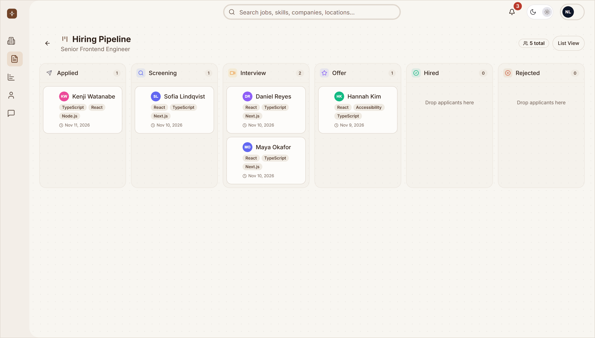<br><sub><b>Pipeline</b>: applicants by stage for one posting</sub></td>
  </tr>
  <tr>
    <td width="50%">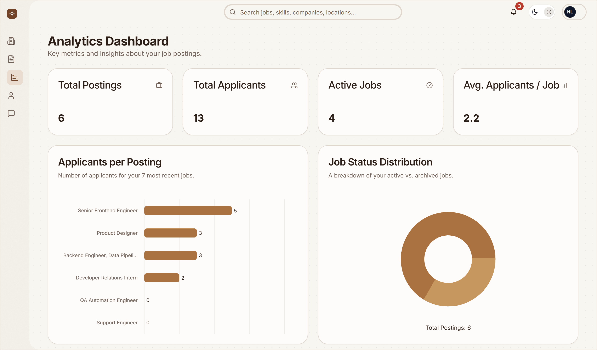<br><sub><b>Analytics</b>: applicants per posting and job status mix</sub></td>
    <td width="50%">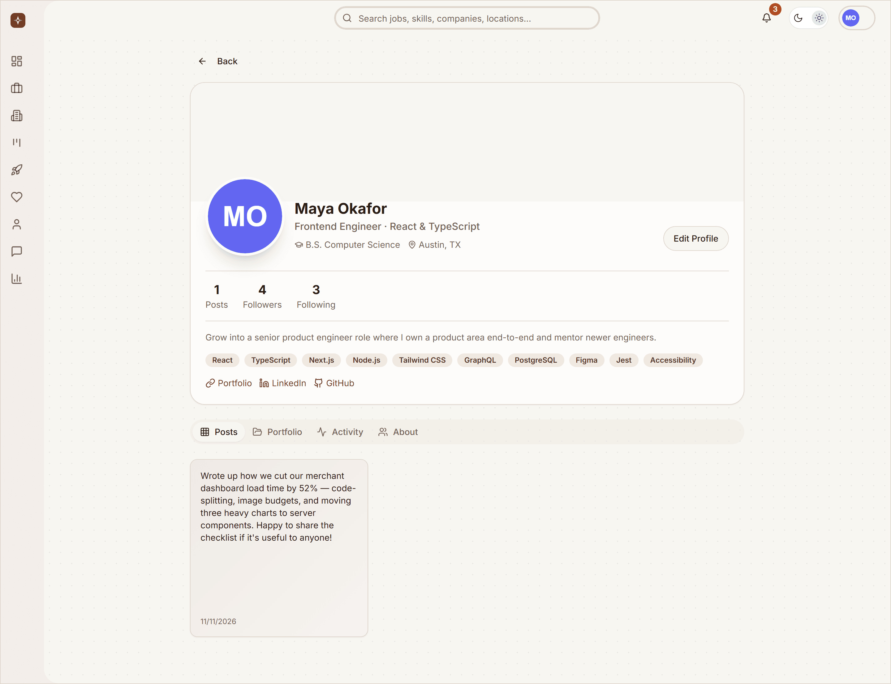<br><sub><b>Profile</b>: the data every match is computed from</sub></td>
  </tr>
</table>

## Tech stack

| Layer | Technology | Why |
|---|---|---|
| Framework | Next.js 15.5 (App Router, Route Handlers, server actions, Turbopack dev) | Pages, AI endpoints and demo seeding in one deployable |
| UI | React 18.3, Tailwind CSS 3.4, shadcn/ui on Radix, Framer Motion, Recharts, next-themes | Accessible primitives on top of the token system |
| Language | TypeScript 5 | Build fails on type errors (`ignoreBuildErrors` is off) |
| Data and auth | Firebase Auth, Cloud Firestore, Cloud Storage (client 11, firebase-admin 13) | Realtime data with security rules, no custom backend to run |
| AI | Genkit 1.15, Gemini 2.5 Flash, offline demo model | Typed flows with Zod schemas and a free local fallback |
| Forms and validation | react-hook-form, Zod 3 | Same schemas for forms and AI flow inputs |
| Documents | pdfjs-dist (resume parsing), jsPDF and html2canvas (resume export) | Parsing and export run in the browser |
| Optional services | Stripe, Resend, Cloudinary | Switched on by env keys |
| Tests | Vitest 3 | Matching, statuses and the demo model |

## Architecture

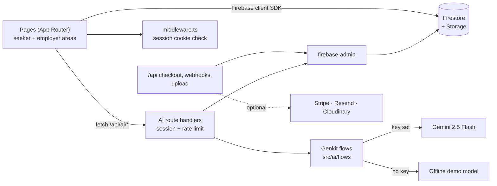

- **Firebase as the backend.** Pages read and write Firestore directly through the client SDK. `firestore.rules` scopes users, opportunities, applications and AI history so people can only touch their own data. Privileged work (checkout, webhooks, role sync, rate limits) runs server-side with `firebase-admin`.
- **Sessions.** The Firebase ID token is mirrored into a session cookie and refreshed with `onIdTokenChanged`; `middleware.ts` checks it before app routes render.
- **AI behind one boundary.** Each tool is a Genkit flow with Zod input and output schemas, called only from `/api/ai/*` handlers that verify the session and apply a shared rate limit.
- **One matching function.** `lib/career.ts` computes skill overlap; the same code powers the seeker's match score and the employer's candidate ranking, so both sides see the same number.
- **Demo seeding** (`lib/demo`) is a server action that creates the guest account and writes a versioned, idempotent data set.

## Engineering highlights

- **Works offline by design.** `src/ai/genkit.ts` picks Gemini when a key is present and otherwise registers a demo model whose answers are validated against each flow's output schema in tests.
- **Fair-use limits that survive restarts.** AI calls are counted per user, per tool and per hour inside a Firestore transaction, with higher limits for paid plans and a typed `AiRateLimitError` that carries `retryAfterSeconds`.
- **Matching that forgives formatting.** "react.js" matches "React", "Node" matches "Node.js", but one-letter tokens like "C" never match "C#".
- **Shared status model.** Seeker and employer views map raw statuses through one module (`lib/application-status.ts`), which also owns the follow-up rule.

The model switch is a few lines:

```ts
// src/ai/genkit.ts
const hasGoogleAiKey = Boolean(
  process.env.GOOGLE_GENAI_API_KEY || process.env.GEMINI_API_KEY || process.env.GOOGLE_API_KEY
);

export const isAiDemoMode = !hasGoogleAiKey;

export const ai = genkit({
  plugins: hasGoogleAiKey ? [googleAI()] : [],
  model: hasGoogleAiKey ? 'googleai/gemini-2.5-flash' : DEMO_MODEL_NAME,
});

if (!hasGoogleAiKey) registerDemoModel(ai);
```

And the matcher that both sides of the product share:

```ts
// src/lib/career.ts
const norm = (s: string) => s.toLowerCase().replace(/[^a-z0-9+#]/g, "");

/** Which of the job's skills a candidate covers ("React" matches "React.js"). */
export function skillOverlap(candidateSkills: unknown, jobSkills: unknown) {
  const mine = splitSkills(candidateSkills).map(norm).filter(Boolean);
  const required = splitSkills(jobSkills);
  const matched: string[] = [];
  const missing: string[] = [];
  for (const skill of required) {
    const n = norm(skill);
    const hit = n && mine.some((m) => m === n ||
      (m.length > 2 && n.length > 2 && (m.startsWith(n) || n.startsWith(m))));
    (hit ? matched : missing).push(skill);
  }
  const pct = required.length ? Math.round((matched.length / required.length) * 100) : 0;
  return { matched, missing, pct };
}
```

## Getting started

### Prerequisites

- Node.js 20+ and npm
- Docker, to run the Firebase emulator suite locally (or a real Firebase project)

### 1. Install

```bash
git clone <your-fork-url> career-wise
cd career-wise
npm install
```

### 2. Start the Firebase emulators

The `emulator/` folder builds an image with the Auth, Firestore and Storage emulators (project `demo-app`). Data persists in a Docker volume.

```bash
docker build -t career-wise-emulator emulator
```

```bash
docker run -d --name career-wise-firebase \
  -p 127.0.0.1:9099:9099 -p 127.0.0.1:8080:8080 -p 127.0.0.1:9199:9199 -p 127.0.0.1:4000:4000 \
  -v career-wise-data:/data \
  -v "$PWD/firestore.rules:/srv/firestore.rules:ro" \
  career-wise-emulator
```

The emulator UI is then at `http://localhost:4000`.

### 3. Configure

Create `.env.local`:

```bash
NEXT_PUBLIC_FIREBASE_API_KEY=demo-key
NEXT_PUBLIC_FIREBASE_AUTH_DOMAIN=demo-app.firebaseapp.com
NEXT_PUBLIC_FIREBASE_PROJECT_ID=demo-app
NEXT_PUBLIC_FIREBASE_STORAGE_BUCKET=demo-app.appspot.com
NEXT_PUBLIC_FIREBASE_MESSAGING_SENDER_ID=0
NEXT_PUBLIC_FIREBASE_APP_ID=demo
NEXT_PUBLIC_FIREBASE_EMULATOR_HOST=127.0.0.1
NEXT_PUBLIC_FIREBASE_AUTH_EMULATOR_PORT=9099
NEXT_PUBLIC_FIRESTORE_EMULATOR_PORT=8080
NEXT_PUBLIC_STORAGE_EMULATOR_PORT=9199
FIREBASE_AUTH_EMULATOR_HOST=127.0.0.1:9099
FIRESTORE_EMULATOR_HOST=127.0.0.1:8080
FIREBASE_STORAGE_EMULATOR_HOST=127.0.0.1:9199
NEXT_PUBLIC_APP_URL=http://localhost:3507
```

<details>
<summary><b>All environment variables</b></summary>

| Variable | Required | Description |
|---|---|---|
| `NEXT_PUBLIC_FIREBASE_*` (API key, auth domain, project ID, storage bucket, sender ID, app ID) | Yes | Firebase web app config |
| `NEXT_PUBLIC_FIREBASE_EMULATOR_HOST`, `NEXT_PUBLIC_*_EMULATOR_PORT` | Local | Point the browser SDK at the emulators |
| `FIREBASE_AUTH_EMULATOR_HOST`, `FIRESTORE_EMULATOR_HOST`, `FIREBASE_STORAGE_EMULATOR_HOST` | Local | Point `firebase-admin` at the emulators |
| `FIREBASE_PROJECT_ID`, `FIREBASE_CLIENT_EMAIL`, `FIREBASE_PRIVATE_KEY` | Production | Service account for `firebase-admin` |
| `NEXT_PUBLIC_APP_URL` | Yes | Public URL, used in emails and checkout redirects |
| `GOOGLE_GENAI_API_KEY` (or `GEMINI_API_KEY`, `GOOGLE_API_KEY`) | No | Use Gemini; without it the offline demo model answers |
| `DEMO_MODE` | No | `true` shows the demo sign-in buttons outside the emulator setup; `false` hides them |
| `ADMIN_EMAILS` | No | Comma-separated emails granted the admin role |
| `RESEND_API_KEY`, `RESEND_FROM_EMAIL` | No | Welcome and application-status emails |
| `STRIPE_SECRET_KEY`, `STRIPE_WEBHOOK_SECRET`, `STRIPE_{STARTER,PRO,PREMIUM,BUSINESS}_{MONTHLY,YEARLY}_PRICE_ID` | No | Paid plans and checkout |
| `CLOUDINARY_CLOUD_NAME`, `CLOUDINARY_API_KEY`, `CLOUDINARY_API_SECRET` | No | Image and file uploads |

</details>

### 4. Run

```bash
npm run dev
```

Open `http://localhost:3507` and pick a demo.

<details>
<summary><b>Scripts</b></summary>

| Script | What it does |
|---|---|
| `npm run dev` | Dev server with Turbopack on port 3507 |
| `npm run build` / `npm start` | Production build and server |
| `npm run lint` | ESLint (Next.js config) |
| `npm run typecheck` | `tsc --noEmit` |
| `npm test` | Vitest suite |
| `npm run genkit:dev` / `npm run genkit:watch` | Genkit developer UI for inspecting and running AI flows |

</details>

<details>
<summary><b>Project structure</b></summary>

```
src/
├── app/
│   ├── page.tsx           # landing page
│   ├── (auth)/            # login, signup, forgot-password
│   ├── (app)/             # dashboard, opportunities/[id]/prepare|apply, applications,
│   │                      # ai-tools/*, saved, profile, inbox, insights, analytics, admin,
│   │                      # employer/ (dashboard, postings/[id]/applicants|pipeline, analytics)
│   ├── onboarding/ pricing/
│   └── api/               # ai/*, upload, checkout, webhooks/stripe, notifications
├── ai/
│   ├── genkit.ts          # model selection (Gemini or offline demo model)
│   ├── demo-model.ts      # schema-matched offline responses
│   └── flows/             # 19 Genkit flows
├── components/            # app shell, today/ home screens, resume-builder, chat, ui/
├── lib/                   # career matching, application statuses, AI history,
│                          # rate limiting, session, Stripe, email, demo/ seeding
└── middleware.ts          # session cookie check
emulator/                  # Dockerfile + config for the Firebase emulator suite
firestore.rules            # security rules
firestore.indexes.json
```

</details>

## Testing and quality

```bash
npm run typecheck
```

```bash
npm run lint
```

```bash
npm test
```

- Vitest covers application status mapping and follow-up rules, skill-overlap matching (including the "C" vs "C#" edge case) and the offline demo model's schema-valid output: 13 tests.
- TypeScript is checked in builds (`ignoreBuildErrors` is off).
- Firestore rules can be exercised against the emulator from the emulator UI.

## Deployment

The repo includes `apphosting.yaml` for **Firebase App Hosting**: connect the repository, set the environment variables above as secrets (Firebase config, service account, `NEXT_PUBLIC_APP_URL` and any optional keys), and deploy `firestore.rules` and `firestore.indexes.json` with the Firebase CLI. It also runs on any Node host with `npm run build && npm start`. Point the Stripe webhook at `/api/webhooks/stripe` when billing is enabled, and set `DEMO_MODE=false` unless you want public demo sign-in.

## Roadmap

- Video interviews (the WebRTC groundwork is behind a feature flag).
- Saved searches with email alerts for new matching roles.
- Shared scorecards so several interviewers can rate a candidate.
- Firestore rules unit tests in CI against the emulator.
- End-to-end tests for the demo, prep pack and apply flows.